I'm **Itumeleng Nthite**, founder and principal of **[Symbolic Synapse](https://symbolicsynapse.co.za)**, an applied AI, robotics and data engineering practice in Johannesburg. We build systems for banks and government departments that are governed, auditable, and built to run inside your network.

**Decide.** Business intelligence, machine learning and governed AI agents that turn operational data into decisions someone can defend. Every answer traces to a source, and every number resolves to a record.

**See.** Drones, quadruped inspection robots, smart glasses and digital twins that verify conditions on site instead of on paper.

**Build.** Prefabricated steel-frame construction, transferred to local fabrication.

And on the trading floor: since 2022, production BI and data engineering inside the Global Markets divisions of South African banks, where a wrong number reaches a trader within the minute.

**[Agent Jo](https://github.com/itumelengj-debug/AgentJo)** is an AI agent that runs on your own machine. It reads files, runs commands, drives a browser and keeps working unattended. Conversations, documents, memory and the tamper-evident audit trail stay on the machine, and it runs fully offline with a local model. Updates are signed and verified before they install.

**[Agent Jo Jobs](https://github.com/itumelengj-debug/agent-jo-jobs)** is a job-search app that runs on your own machine and won't send an application that misrepresents you. It finds and scores roles and drafts the application. It holds any draft that claims a tool, an employer or years of experience your profile can't support. It never signs in, creates accounts or ticks consent boxes for you.

**[DogSense HUD](https://github.com/itumelengj-debug/dogsense-hud)** gives real-time canine behaviour telemetry on Rokid RV101 smart glasses. It fuses dog pose with bioacoustics, using ordered, explainable rules so every state traces back to its cues. Learned perception, symbolic reasoning: a research prototype that reports what it saw and heard.

**[powerbi-llm](https://github.com/itumelengj-debug/powerbi-llm)** is a Power BI specialist model for Ollama. It scores 12/12 on a 12-task Power BI benchmark at about 156 tokens a second on a single 24 GB GPU, with no cloud API. In grounded mode it answers from about 1,326 Power BI and Fabric documents, cites them, and marks anything uncovered as unverified.

Three working demonstrations of how we build: governed answers, name screening and bid scoring. They run in your browser on fictional samples. **[Open the Lab →](https://symbolicsynapse.co.za/lab.html)**

  &nbsp;
  &nbsp;
  

